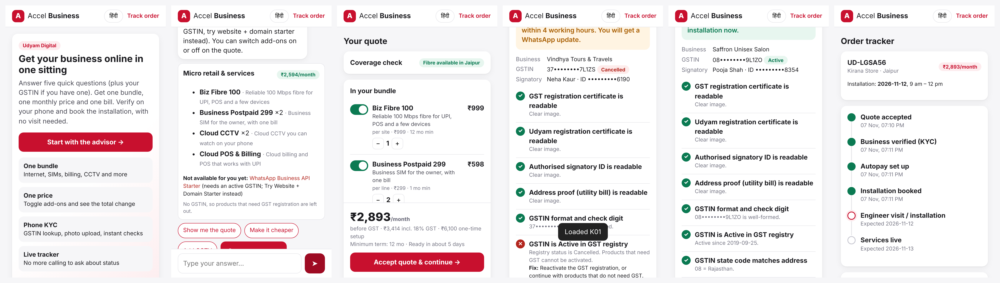
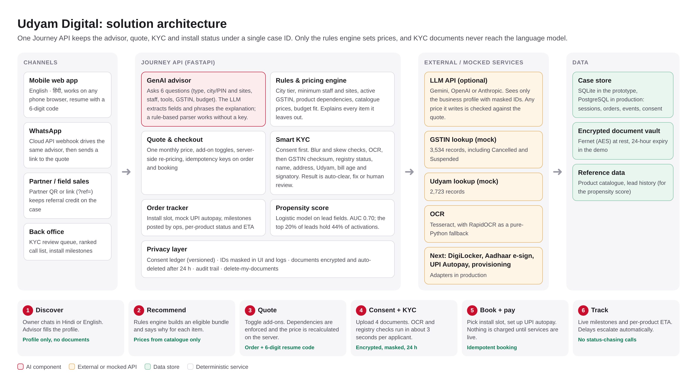

# Udyam Digital: small businesses online in one sitting

**YTL Hackathon 2026 · Enterprise Track A · Team cartel (BIT Mesra)**

A working prototype of a digital-first acquisition and onboarding journey for **Accel Business**. A small-business owner chats with a GenAI advisor in Hindi or English, gets one eligible bundle with one monthly price, verifies the business on a phone with Smart KYC, books installation and tracks it without calling anyone.



## What it does (mapped to the build challenge)

| Required | How the prototype does it |
|---|---|
| **GenAI advisor** | Asks five short questions (business type, city/PIN and sites, headcount, current tools and needs, budget) plus an optional GSTIN. The owner can also say everything in one message. An LLM (Gemini, OpenAI or Anthropic; optional) extracts the profile and writes the explanation. A **deterministic rules engine** picks products using city tier, minimum staff and sites, active GSTIN and `requires_one_of` dependencies, and explains every item it leaves out (for example "WhatsApp Business API needs an active GSTIN; try Website + Domain instead"). Budget fitting drops optional add-ons first, then steps plans down. A built-in rule-based parser means it works with **no API key**. |
| **Quote & checkout** | One monthly price with setup, 18% GST, minimum term and install days. Add-ons toggle on and off, per-unit items have quantity steppers, and everything is **re-priced on the server**. Removing a dependency removes what relies on it. Orders and bookings use **idempotency keys**, so retries never create duplicates. |
| **Smart KYC** | Consent screen first. Upload 4 documents (or load samples K01–K12). The pipeline checks blur, straightens skewed scans, strips the watermark and runs OCR (Tesseract, or RapidOCR as a fallback). It then checks the **GSTIN check digit**, the **mock GSTIN registry** (Active / Cancelled / Suspended), state code, names, address, the **mock Udyam registry**, address proof age (≤ 90 days on 2026-07-15), signatory validity and the proprietor match. The outcome is **auto-clear**, **back to owner with a fix**, or **human review**. |
| **Tracker** | Order ID plus a 6-digit code. Shows the timeline (quote → KYC → autopay → install booked → installation → live), per-product status and ETA, help contacts, and "Delete my documents". |
| Stretch: WhatsApp front end | `/api/whatsapp/webhook` (WhatsApp Cloud API) drives the same advisor and replies with a link to the quote. |
| Stretch: back office for sales/partners | `/admin`: KYC review queue (approve/reject), advisor chats not closed, orders, and "post next milestone" for ops. Partner links (`?ref=CODE`) keep referral credit on the case. |
| Stretch: propensity score | Logistic regression on lead-time fields from `smb_leads.csv`. Holdout **AUC 0.70**; the **top 20% of leads hold 44% of activations**. Powers the "Who to call next" list. |

## Results on the case data

- **Smart KYC: 12/12 sample applicants routed correctly.** See [docs/kyc_results.md](docs/kyc_results.md). K01 (cancelled GSTIN, blank Udyam number) and K07 (legal name ≠ trade name) go to a reviewer. K04 (blurry), K05 (Udyam missing) and K11 (bill 257 days old) go back to the owner. K02 is straightened automatically, and it and the rest clear automatically.
- **Advisor: 15/15 test conversations produce bundles that pass every catalogue rule.** See [docs/advisor_scenarios.md](docs/advisor_scenarios.md).
- `python -m pytest -q` → **22 tests pass** (rules, pricing, dependencies, budget and all 12 KYC applicants).

## Run it (Mac)

```bash
# 1. one-time: OCR engine (optional; without it run.sh installs a pure-Python OCR)
brew install tesseract

# 2. the data pack must sit next to this folder:  airtel/YTL_TrackA_Udyam_Digital_Data
#    (or: export DATA_DIR=/path/to/YTL_TrackA_Udyam_Digital_Data)

# 3. start
cd udyam-digital
./run.sh
```

Open **http://localhost:8000** (use Chrome DevTools phone view) and **http://localhost:8000/admin** for the back office.

Optional settings (environment variables):

| Variable | Effect |
|---|---|
| `GEMINI_API_KEY` / `OPENAI_API_KEY` / `ANTHROPIC_API_KEY` | Turns on the LLM for profile extraction and explanations (`LLM_MODEL` overrides the model) |
| `WHATSAPP_VERIFY_TOKEN`, `WHATSAPP_TOKEN`, `WHATSAPP_PHONE_ID`, `PUBLIC_URL` | WhatsApp Cloud API webhook |
| `VAULT_KEY` | Fernet key for the document vault (otherwise generated in `var/vault.key`) |
| `DATA_DIR` | Path to the data pack |

Tests: `./.venv-Darwin/bin/python -m pip install pytest httpx && ./.venv-Darwin/bin/python -m pytest -q`

Troubleshooting: if startup fails with `sqlite3.OperationalError: disk I/O error` (network or synced folders), run `APP_VAR_DIR=/tmp/udyam ./run.sh`. If port 8000 is busy, use `PORT=8080 ./run.sh`.

## Architecture



- **Journey API**: FastAPI (`backend/main.py`). One case ID covers advisor session → order → KYC → install.
- **Advisor**: `backend/advisor.py` (slot filling, English and Hindi) + `backend/llm.py` (provider-agnostic HTTPS client, optional).
- **Rules & pricing**: `backend/rules.py`. The only place products and prices are decided.
- **Smart KYC**: `backend/kyc.py`. Image quality, OCR, field parsing, registry cross-checks, decision.
- **Storage**: `backend/store.py`. SQLite for the prototype (same tables move to PostgreSQL in production), Fernet-encrypted document vault with 24-hour expiry, audit log, idempotency table, propensity scoring.
- **Front end**: `frontend/` (plain HTML/CSS/JS, mobile-first, no build step). `index.html` is the owner app and `admin.html` the back office.

## Privacy & security (summary)

Consent comes before upload (versioned and stored). Each step collects only what it needs. The **LLM never sees documents** and never sets prices (rupee amounts in its text are checked against the quote). IDs are masked in the UI, API and logs. Documents are encrypted at rest and auto-deleted after 24 hours, and the owner can delete them on demand. Human review handles registry and identity problems. Full one-pager: [docs/Privacy_Security_Note.pdf](docs/Privacy_Security_Note.pdf).

## Project layout

```
backend/   main.py (API) · advisor.py · llm.py · rules.py · kyc.py · store.py · data.py · propensity_model.json
frontend/  index.html · app.js · styles.css · admin.html
scripts/   run_kyc_samples.py · run_advisor_scenarios.py
tests/     test_rules.py · test_kyc.py
docs/      architecture.png · Privacy_Security_Note.pdf · kyc_results.md · advisor_scenarios.md · demo_video_script.md · screenshots/
```

## Limitations and next steps

- Payment (UPI Autopay), DigiLocker, Aadhaar e-sign and network provisioning are mocked. Coverage is mocked by city.
- Back-office access uses a demo token; production needs SSO, roles and row-level access.
- Hindi covers the advisor and the main screens; KYC check labels are English.
- All data is synthetic (Accel YTL Hackathon pack). The 90-day rule and the 2026-07-15 date come from the case.
